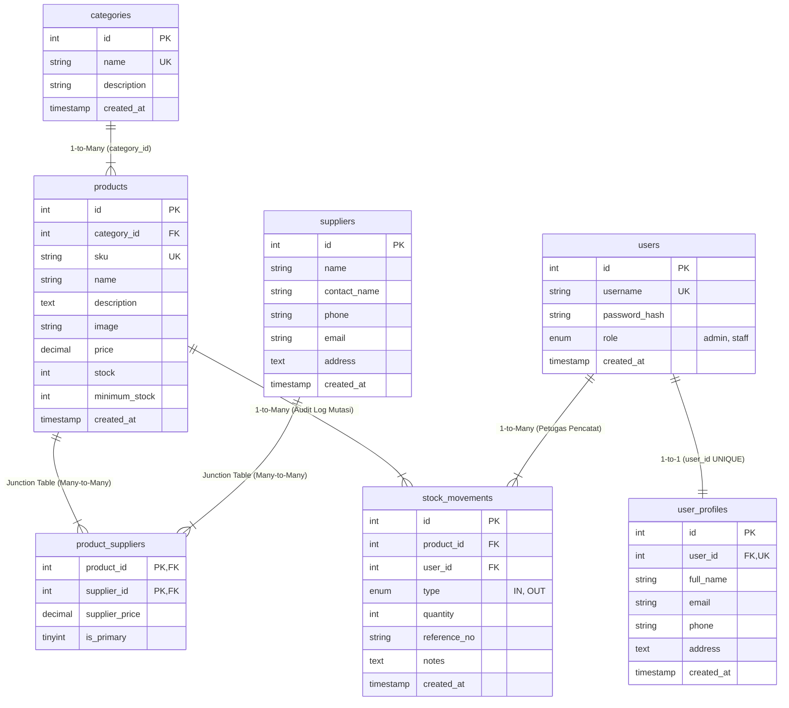

# InventoryPro — Inventory Management System
> **Mini Project 4 — Relational Database + Advanced PHP**  
> *Penerus resmi dan penyempurnaan dari Mini Project 3: Dari CRUD Tunggal Menuju Aplikasi Berbasis Relasi, Transaksi ACID, Laporan Bisnis, dan Otorisasi Multi-Peran.*

---

## 📌 Ringkasan Proyek

Proyek ini merupakan implementasi lengkap dari materi **Pertemuan 4 (Pemrograman Web)**: *Relational Database + Advanced PHP*. Aplikasi ini dirancang untuk menjawab tantangan tata kelola persediaan barang di dunia nyata (Enterprise Inventory System) yang memerlukan:
- Integritas data relasional antar-tabel (One-to-One, One-to-Many, Many-to-Many).
- Keamanan transaksi mutasi stok menggunakan prinsip ACID (`beginTransaction`, `FOR UPDATE`, `commit`, `rollBack`).
- Kontrol akses berbasis peran (Role-Based Access Control: `Admin` vs `Staff`).
- Laporan bisnis dengan agregasi SQL tingkat lanjut (`COUNT`, `SUM`, `AVG`, `GROUP BY`, `HAVING`).

---

## 🚀 Perbandingan & Evolusi: Mini Project 3 vs Mini Project 4

| Aspek | Mini Project 3 (Sebelumnya) | Mini Project 4 (Proyek Ini) |
| :--- | :--- | :--- |
| **Arsitektur Database** | 1 Tabel Datar (`products` saja) | **7 Tabel Relasional** terintegrasi penuh |
| **Kategori Barang** | Teks biasa (`VARCHAR`) | **Tabel Relasi 1-to-Many** (`categories` &rarr; `products`) |
| **Rantai Pasok (Supplier)** | Tidak ada | **Tabel Relasi Many-to-Many** (`products` &harr; `suppliers` via `product_suppliers`) |
| **Pencatatan Stok** | Edit manual angka kolom stok | **Audit Trail Transaksi** (`stock_movements`) dengan jenis mutasi `IN` dan `OUT` |
| **Integritas Stok** | Tidak ada proteksi minus | **Row Locking `FOR UPDATE`** & pencegahan mutlak stok menjadi negatif |
| **Autentikasi & Akun** | Tanpa login (halaman publik bebas) | **Session Security & Bcrypt Hashing** (`password_verify`, `session_regenerate_id`) |
| **Otorisasi Pengguna** | Tidak ada peran | **RBAC (Admin vs Staff)** dengan HTTP 403 Forbidden untuk akses terlarang |
| **Profil Pengguna** | Tidak ada | **Relasi 1-to-1** (`users` &harr; `user_profiles`) |
| **Pelaporan Bisnis** | Hanya daftar produk | **Dashboard Agregat & Laporan Valuasi** (`SUM(stock*price)`, perputaran barang masuk/keluar) |
| **Sorting & Filter** | Pencarian teks sederhana | **Allowlist Whitelisting**, filter kategori, filter status stok, & pagination dinamis |
| **Visual & Media Produk** | Tanpa foto produk | **Foto Produk Studio Resolusi Tinggi** pada katalog, halaman detail, dan dashboard |

---

## 🗄️ Diagram Relasi Database (ERD)

Aplikasi dibangun di atas basis data relasional `inventory_db` dengan struktur berikut:



### Keterangan Integritas Relasional (Referential Integrity):
1. **One-to-One (`users` &harr; `user_profiles`)**: Kolom `user_id` pada tabel profil diberi constraint `UNIQUE` dan `FOREIGN KEY ... ON DELETE CASCADE`.
2. **One-to-Many (`categories` &rarr; `products`)**: Kolom `category_id` menggunakan `ON DELETE RESTRICT` (kategori tidak dapat dihapus jika masih menaungi produk).
3. **Many-to-Many (`products` &harr; `suppliers`)**: Dihubungkan melalui *junction table* `product_suppliers` dengan *composite primary key* `(product_id, supplier_id)` dan menyimpan harga pasokan `supplier_price`.
4. **Audit Trail Mutasi (`stock_movements`)**: Menggunakan `ON DELETE RESTRICT` terhadap `product_id` dan `user_id` agar riwayat transaksi masa lalu tidak pernah terhapus secara sengaja maupun tidak sengaja.

---

## 🔑 Akun Demo Pengguna Bawaan (Default Credentials)

Aplikasi telah dilengkapi dengan data benih (*seed data*) untuk pengujian langsung:

| Peran (Role) | Username | Password | Deskripsi Hak Akses |
| :--- | :--- | :--- | :--- |
| **Administrator** | `admin` | `admin123` | Akses penuh: manajemen produk, kategori, supplier, transaksi, laporan bisnis, dan modul akun pengguna. |
| **Staff Gudang** | `staff` | `staff123` | Akses operasional: melihat katalog, mencatat barang masuk (`IN`), mencatat barang keluar (`OUT`), melihat histori mutasi & laporan. Dilarang mengakses menu administrasi pengguna. |

> *Catatan: Pada halaman login tersedia tombol pintas (**Demo Admin** dan **Demo Staff**) untuk mengisi kredensial dengan satu klik.*

---

## 📋 Penerapan Aturan Bisnis (Business Rules - Slide 33)

Sesuai instruksi pada Slide 33 modul perkuliahan, sistem menerapkan seluruh aturan bisnis berikut secara ketat di sisi server:

1. **SKU Harus Unik**:
   - Divalidasi di server (`validateSku()`) dan dikunci di tingkat basis data dengan `UNIQUE INDEX`.
2. **Harga dan Quantity Tidak Boleh Negatif**:
   - Menggunakan `FILTER_VALIDATE_INT` dan `FILTER_VALIDATE_FLOAT` dengan parameter batasan numerik (`min >= 0` atau `min > 0`).
3. **Barang Keluar Tidak Boleh Melebihi Stok**:
   - Sebelum stok dikurangi, server mengunci baris produk (`SELECT stock FROM products WHERE id = :id FOR UPDATE`) dan memeriksa `if ($quantity > $stock) throw new Exception()`.
4. **Stok Tidak Boleh Menjadi Negatif**:
   - Jika stok tidak mencukupi, transaksi otomatis dibatalkan seluruhnya (*rollback*) dan tidak ada pengurangan stok maupun pencatatan riwayat palsu.
5. **Produk Berhistori Dilarang Dihapus**:
   - Saat admin mencoba menghapus produk, server memeriksa tabel `stock_movements`. Jika produk telah memiliki catatan transaksi, penghapusan ditolak demi kepatuhan audit inventaris.
6. **Halaman Internal Membutuhkan Login**:
   - Fungsi `requireLogin()` mencegat akses tanpa izin dan mengarahkan pengguna ke `login.php`.
7. **Staff Dilarang Mengakses Administrasi User**:
   - Fungsi `requireAdmin()` mengembalikan kode respons **HTTP 403 Forbidden** dan menampilkan halaman penolakan resmi jika staff mencoba mengakses modul `/public/users/`.
8. **Sorting Kolom Hanya Menggunakan Allowlist**:
   - Parameter `$_GET['sort']` dan `$_GET['order']` dicocokkan dengan daftar kolom yang diizinkan (`['name', 'sku', 'price', 'stock', 'created_at']`), mencegah injeksi manipulasi klausa SQL ORDER BY.

---

## 🧪 Panduan Pembuktian & Pengujian Fitur (Slide 38)

### 1. Uji Kasus Validasi Error (Validation Error)
- **Tujuan**: Membuktikan bahwa stok tidak dapat dikeluarkan melebihi persediaan fisik (Slide 26 & 33).
- **Langkah Pengujian**:
  1. Login ke aplikasi (sebagai `admin` atau `staff`).
  2. Buka menu **Barang Keluar (OUT)** (`/public/stock/out.php`).
  3. Pilih produk **Keychron K2 V2 Wireless** (stok saat ini: 3 unit).
  4. Masukkan jumlah keluar: `10` unit.
  5. Klik tombol **Konfirmasi Barang Keluar**.
  6. **Hasil yang Diharapkan**: Sistem menampilkan kotak peringatan merah: *"Gagal: Jumlah pengeluaran (10 unit) melebihi stok yang tersedia di gudang (3 unit). Stok tidak boleh menjadi negatif."* Data stok produk tetap utuh (3 unit) dan transaksi di-*rollback*.

### 2. Uji Kasus Akses Terlarang (HTTP 403 Forbidden)
- **Tujuan**: Membuktikan bahwa staff tidak diizinkan mengakses modul administrasi pengguna (Slide 24 & 38).
- **Langkah Pengujian**:
  1. Login sebagai Staff Gudang (`staff` / `staff123`).
  2. Akses URL administratif secara langsung: `http://localhost:8000/public/users/index.php`.
  3. **Hasil yang Diharapkan**: Server merespons dengan kode status **HTTP 403 Forbidden** dan menampilkan antarmuka penolakan: *"403 — Akses Ditolak: Peran akun Anda saat ini (staff) tidak memiliki izin otorisasi untuk mengakses halaman administratif ini."*

### 3. Uji Kasus Integritas Penghapusan (Referential Integrity Check)
- **Tujuan**: Membuktikan bahwa produk yang memiliki histori transaksi mutasi tidak dapat dihapus sembarangan (Slide 9 & 33).
- **Langkah Pengujian**:
  1. Login sebagai `admin`.
  2. Masuk ke halaman **Katalog Produk** (`/public/products/index.php`).
  3. Temukan produk **MacBook Air M2** (memiliki riwayat mutasi masuk & keluar).
  4. Klik tombol hapus (ikon tempat sampah).
  5. **Hasil yang Diharapkan**: Penghapusan ditolak dengan pesan: *"Gagal Menghapus: Produk 'MacBook Air M2 256GB' memiliki catatan transaksi. Sesuai aturan bisnis dan integritas referensial, produk yang memiliki histori tidak boleh dihapus."*

### 4. Uji Kasus Transaksi Barang Masuk (Restock ACID Transaction)
- **Tujuan**: Membuktikan pertambahan stok dan pencatatan audit trail serentak (Slide 25 & 27).
- **Langkah Pengujian**:
  1. Buka menu **Barang Masuk (IN)** (`/public/stock/in.php`).
  2. Pilih produk yang menipis (misal: **Ubiquiti UniFi U6-Pro**, stok awal: 2 unit).
  3. Masukkan jumlah: `10` unit, nomor referensi `PO-2026-TEST`.
  4. Simpan transaksi.
  5. **Hasil yang Diharapkan**: Stok produk bertambah menjadi 12 unit, status stok berubah menjadi "Tersedia", dan riwayat transaksi langsung muncul pada **Histori Mutasi Stok** dan **Dashboard**.

---

## 💻 Panduan Instalasi & Menjalankan Proyek

### Prasyarat Sistem
- PHP versi 8.0 ke atas dengan ekstensi `pdo_mysql` aktif.
- MySQL atau MariaDB Server (misalnya melalui XAMPP atau Laragon).
- Web browser modern (Chrome, Edge, Firefox, dll).

### Langkah Menjalankan:

#### Opsi 1: Menggunakan XAMPP
1. Pastikan modul **Apache** dan **MySQL** aktif pada XAMPP Control Panel.
2. Buka `phpMyAdmin` (`http://localhost/phpmyadmin/`).
3. Import file database:
   - Pilih tab **Import**.
   - Arahkan ke file `database/schema.sql` di dalam folder proyek ini, lalu klik **Go**.
   - Database `inventory_db` beserta tabel dan data awal akan otomatis terbentuk.
4. Letakkan folder proyek ini di dalam `C:\xampp\htdocs\mini project 4`.
5. Buka browser dan kunjungi:
   ```
   http://localhost/mini%20project%204/
   ```

#### Opsi 2: Menggunakan PHP Built-in Web Server (CLI)
1. Buka terminal (PowerShell atau Command Prompt) di dalam folder proyek:
   ```powershell
   cd "C:\Users\Gamal\Documents\Tugas\mini project 4"
   ```
2. Pastikan MySQL service sedang berjalan (port 3306).
3. Import skema database jika belum diimport:
   ```powershell
   Get-Content database\schema.sql | C:\xampp\mysql\bin\mysql.exe -u root
   ```
4. Jalankan server lokal:
   ```powershell
   C:\xampp\php\php.exe -S 127.0.0.1:8000
   ```
5. Buka browser pada URL:
   ```
   http://127.0.0.1:8000
   ```

---

## 📂 Struktur Direktori Proyek

```
mini project 4/
├── config/
│   └── database.php         # Konfigurasi PDO, Charset UTF-8, Native Prepares
├── helpers/
│   ├── auth.php             # Session, isLoggedIn, requireAdmin, CSRF, Flash
│   ├── escape.php           # Sanitasi XSS (htmlspecialchars), Rupiah & Date format
│   └── validation.php       # Syntactic, semantic, dan sorting allowlist validation
├── database/
│   └── schema.sql           # Skema 7 tabel relasional, FK constraints, dan mock data
├── public/
│   ├── assets/
│   │   ├── css/style.css    # Modern UI design system (Glassmorphism, responsive)
│   │   └── js/main.js       # Client interaction, stock calculator, demo autofill
│   ├── login.php            # Autentikasi pengguna, Bcrypt verify, CSRF check
│   ├── logout.php           # Pembersihan sesi aman & penghapusan cookie
│   ├── dashboard.php        # Ringkasan KPI bisnis, alert stok kritis, audit stream
│   ├── products/
│   │   ├── index.php        # Search, filter kategori/stok, sorting, pagination
│   │   ├── create.php       # Form input produk & relasi supplier (Admin)
│   │   ├── edit.php         # Form ubah data produk & harga pasokan (Admin)
│   │   ├── detail.php       # Detail spesifikasi, daftar supplier, & mutasi produk
│   │   └── delete.php       # Hapus produk dengan proteksi referensial berhistori
│   ├── categories/
│   │   ├── index.php        # Laporan agregat kategori (COUNT, SUM, AVG)
│   │   ├── create.php       # Tambah kategori baru
│   │   ├── edit.php         # Edit nama & deskripsi kategori
│   │   └── delete.php       # Hapus kategori (dengan cek produk terhubung)
│   ├── suppliers/
│   │   ├── index.php        # Daftar rekanan & total produk yang dipasok
│   │   ├── create.php       # Tambah mitra pemasok baru
│   │   ├── edit.php         # Edit profil kontak pemasok
│   │   ├── detail.php       # Detail supplier & produk yang dipasok (Many-to-Many)
│   │   └── delete.php       # Hapus supplier
│   ├── stock/
│   │   ├── in.php           # Transaksi barang masuk (IN) dengan ACID commit
│   │   ├── out.php          # Transaksi barang keluar (OUT) dengan row locking
│   │   └── history.php      # Audit log mutasi stok, filter tanggal, & pagination
│   ├── reports/
│   │   └── index.php        # Laporan agregat perputaran stok & print stylesheet
│   └── users/
│       ├── index.php        # Daftar akun login & profil 1-to-1 (Admin only)
│       ├── create.php       # Tambah akun login & profil baru dengan Bcrypt
│       ├── edit.php         # Edit profil & reset kata sandi
│       └── delete.php       # Hapus akun (dengan proteksi self-deletion)
├── views/
│   ├── header.php           # Header HTML, meta tags, top navigation, flash alerts
│   ├── footer.php           # Penutup container, script runner, attribution
│   ├── navbar.php           # Sidebar modern dengan active link highlighting
│   └── forbidden.php        # Halaman respons HTTP 403 Forbidden resmi
├── index.php                # Root redirect otomatis ke dashboard atau login
└── README.md                # Dokumentasi komprehensif proyek
```

---

## 🛡️ Aspek Keamanan Aplikasi yang Diterapkan

1. **Pencegahan SQL Injection**: Seluruh interaksi database menggunakan PDO Prepared Statements dengan parameter binding (`:param`). Tidak ada penggabungan teks langsung (*concatenation*) ke string SQL.
2. **Pencegahan XSS (Cross-Site Scripting)**: Semua output data pengguna yang dicetak ke dokumen HTML dienkripsi melalui fungsi `e()` (`htmlspecialchars(..., ENT_QUOTES, 'UTF-8')`).
3. **Pencegahan CSRF (Cross-Site Request Forgery)**: Setiap form mutasi (`POST`) menyertakan token acak `csrf_token` bertaraf kriptografi (`random_bytes`) yang diverifikasi secara ketat sebelum eksekusi.
4. **Pencegahan Session Hijacking & Fixation**: Panggilan `session_regenerate_id(true)` dieksekusi secara instan saat otentikasi berhasil. Cookie sesi dikonfigurasi dengan flag `HttpOnly` dan `SameSite=Lax`.
5. **Keamanan Password**: Kata sandi disimpan secara searah menggunakan algoritma **Bcrypt** (`PASSWORD_BCRYPT`) dengan garam (*salt*) dinamis melalui `password_hash()` dan diverifikasi dengan `password_verify()`.

---

Dikerjakan oleh **Gamaliel Toto Sinulingga**  
*Mata Kuliah Pemrograman Web — Pertemuan 4 (Relational Database + Advanced PHP)*
